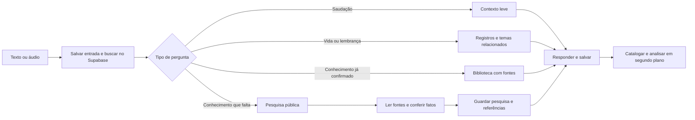
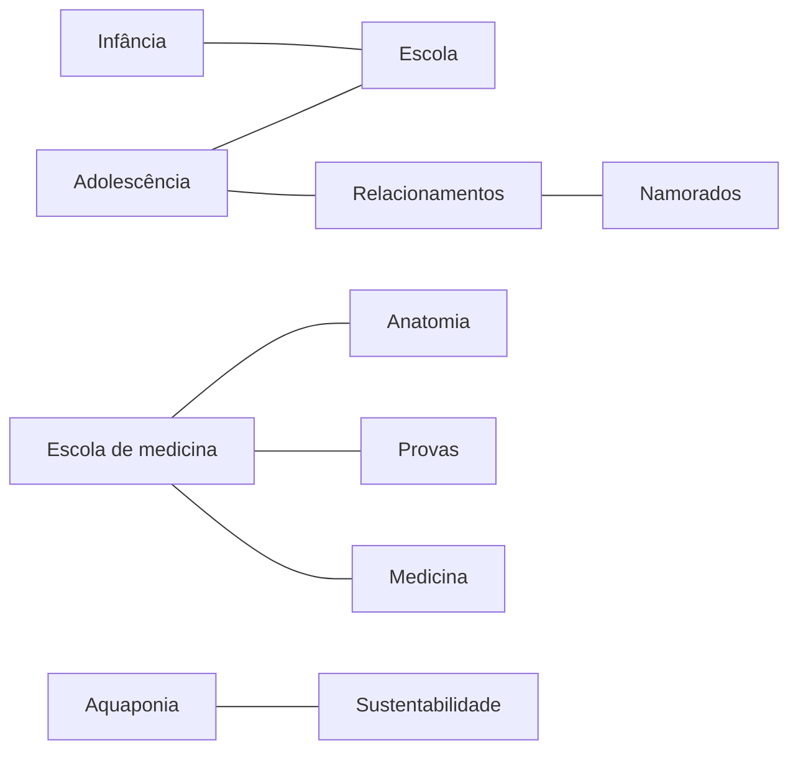

# Organização da Marcella e limites do fluxo

Atualizado em 26/10/2026. Esta entrega cobre n8n e Supabase. A saída de voz está preparada, com ElevenLabs desativada.

## Modelos em uso

| Trabalho | Modelo |
|---|---|
| Conversa em personagem | `gpt-4o-mini` |
| Classificação da pergunta, catalogação e análise da conversa | `gpt-4o-mini` |
| Conferência dos fatos nas páginas | `gpt-4o-mini` |
| Pesquisa pública, somente quando necessária | `gpt-5-mini`, Responses API com `web_search` |
| Transcrição de áudio de entrada | `whisper-1` |

A pesquisa usa a credencial OpenAI que já existia no n8n. A ferramenta web tem a cobrança normal da OpenAI, além dos tokens. Nenhuma API ElevenLabs foi cadastrada ou chamada. [Documentação oficial da pesquisa web](https://developers.openai.com/api/docs/guides/tools-web-search).

## Um caminho que termina

Não há aresta que volte para começar outra pesquisa. O aprendizado em segundo plano não chama o fluxo de diálogo. O crescimento dos dados não cria novos workflows.

| Limite | Configuração |
|---|---|
| Pesquisa por pergunta | Uma chamada ao modelo de pesquisa |
| Ações do buscador dentro dessa chamada | Até 3 |
| Páginas lidas para conferência | Até 4, HTTPS, em fontes primárias permitidas |
| Conferência por pergunta pesquisada | Uma chamada ao verificador |
| Medicina educativa | Evidências em pelo menos 2 hosts distintos |
| Execução do workflow | Limite de 180 segundos |
| Consulta aos temas relacionados | Um salto, sem recursão; até 18 temas selecionados |
| Resultados de arquivo | Até 8 conversas; contexto do modelo usa trechos limitados |
| Categorias por análise | Até 6 temas e até 3 relações por tema |
| Reanálise após falha | Até 3 tentativas; retomada após 5 minutos |

A fila é conferida uma vez por minuto e também é acionada após uma resposta. Ela não fica chamando modelos sem uma conversa pendente.

## O que acontece nos exemplos do Marcos

**“Oi, tudo bem?”**: usa o prompt curto da personagem. Não envia biblioteca, biografia extensa ou arquivo antigo ao modelo.

**“Como foi sua prova de anatomia?”**: procura informação nas memórias e nas conversas anteriores. Uma pergunta antiga ou uma resposta inventada pela própria assistente não confirma que a prova aconteceu. Se não houver registro afirmativo pertinente, a resposta é que ainda não existe um registro confirmado. A internet não é usada para preencher biografia.

**“Como funciona o coração?”**: procura primeiro na biblioteca do Supabase. Se a informação for insuficiente ou exigir atualização, pesquisa na web, abre páginas de fontes primárias e verifica afirmações contra trechos efetivamente encontrados. Guarda os fatos, URLs, trechos de evidência, hash do conteúdo consultado e data. A resposta usa os fatos conferidos com suas citações, evitando uma nova expansão livre que acrescente explicações sem apoio.

**Nova pergunta sobre o mesmo conhecimento**: pode reutilizar a biblioteca sem nova pesquisa. O teste de reaproveitamento confirmou ausência de uma nova linha de pesquisa para a pergunta seguinte. Pesquisas comuns expiram para reutilização após 30 dias; assuntos dependentes de atualização, após 6 horas. Os registros anteriores permanecem como histórico.

Verificação automatizada ajuda a conferir apoio nas fontes, mas pode errar. Ela não equivale a revisão humana ou validação clínica. A personagem continua sem oferecer diagnóstico, prescrição ou atendimento.

## Temas que se conectam

Os temas iniciais por fase continuam nas tabelas existentes. Temas novos são fichas em `memoria_temas`, ligados por `temas_relacoes`. `conversas_temas` e `biblioteca_documentos_temas` ligam as informações às categorias. `memoria_itens` recebe fatos aprovados em temas que ainda não possuem uma tabela antiga própria.

Assim, o tema “escola” pode reunir infância e adolescência, e uma conversa pode pertencer a mais de um tema. Criar “namorados” não inventa um namorado. O catálogo é organização; o conteúdo da biografia permanece separado.

O analisador recebe o catálogo relevante existente para reutilizar categorias. Foi testado criar “aquaponia”, ligar a “sustentabilidade” e reutilizar o mesmo tema numa conversa posterior. O modelo não tem uma ferramenta para executar DDL nem criar bancos, tabelas ou workflows por conta própria.

## Memória completa com contexto limitado

Texto enviado, transcrição da entrada de voz e resposta ficam no Supabase. O áudio original não é armazenado nesta versão. O histórico completo tem índice de busca em português; a recuperação não se limita às últimas mensagens. O teste incluiu uma informação antiga, seguida por 18 registros mais recentes, e recuperou o fato correto.

O histórico recente usado como continuidade vem da sessão atual. Conversas de outras sessões entram como resultados de pesquisa pertinentes. Cânone, relatos do usuário, memórias pessoais e conhecimento de fontes têm origem identificada.

A busca atual é textual, com ranking e relações de temas; não utiliza embeddings. Novas grafias ou sinônimos podem exigir refinamento do catálogo. Os limites de contexto continuam os mesmos quando o banco cresce.

Os testes usam `is_test=true`, separados do contato real. Respostas de testes reprovadas continuam no registro de auditoria com status de erro e são excluídas da recuperação normal. A aprovação de propostas segue sendo uma decisão explícita de Marcos.

## Operação

- [Diálogo](https://n8n.sussamgt.com.br/workflow/rnfVpYWIdwCdZcm4)
- [Pesquisa e recuperação](https://n8n.sussamgt.com.br/workflow/3BehSMjIJkJ1JnNR)
- [Aprendizado e catalogação](https://n8n.sussamgt.com.br/workflow/qhZrYtEZ44U9dJ9r)
- [Consulta e revisão](https://n8n.sussamgt.com.br/workflow/wfdzgCGRFyFvDN0m)
- [Saída de áudio preparada](https://n8n.sussamgt.com.br/workflow/zvmxSgu5p6g1zWFs)

As proteções de RLS e o acesso pelo backend foram mantidos. Os dados das execuções de produção não são copiados para os logs do n8n. O banco continua sendo o registro de estado das conversas, da fila, das pesquisas e das propostas.
